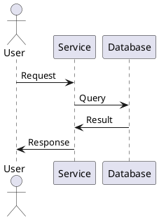
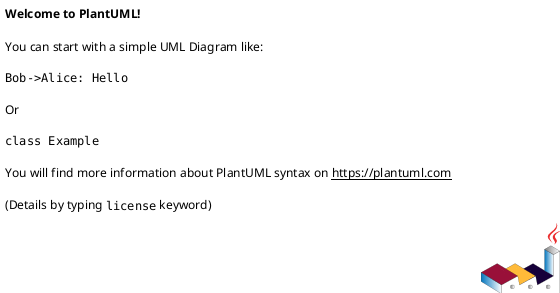
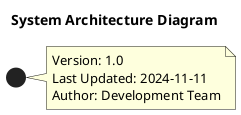

# PlantUML Diagrams

This folder contains all visual documentation for the User Progress Service in PlantUML format.

## Available Diagrams

| Diagram | File | Description |
|---------|------|-------------|
| **Database ER Diagram** | [database-diagram.puml](database-diagram.puml) | Complete entity-relationship diagram with all tables, columns, types, constraints, and relationships |
| **Component Diagram** | [component-diagram.puml](component-diagram.puml) | Service component architecture showing controllers, services, repositories, and their interactions |
| **Sequence Diagram** | [sequence-diagram.puml](sequence-diagram.puml) | Progress tracking workflow showing complete request-response lifecycle |
| **Architecture Diagram** | [architecture-diagram.puml](architecture-diagram.puml) | SOAWEB-React platform microservices architecture with current and future integrations |
| **Class Diagram** | [class-diagram.puml](class-diagram.puml) | Domain model with entities, DTOs, enums, services, repositories, and relationships |

## Viewing PlantUML Diagrams

### Online Viewers

#### Option 1: PlantUML Online Server (Easiest)

1. Go to http://www.plantuml.com/plantuml/uml/
2. Copy the content of any `.puml` file
3. Paste in the text area
4. View the generated diagram

#### Option 2: PlantUML Web Server

1. Visit http://www.plantuml.com/plantuml/
2. Click "PlantUML Web Server"
3. Upload the `.puml` file or paste content

### IDE Integration

#### Visual Studio Code

**Install Extension:**

```bash
code --install-extension jebbs.plantuml
```

Or search for "PlantUML" in Extensions marketplace.

**View Diagram:**

1. Open any `.puml` file
2. Press `Alt+D` (Windows/Linux) or `Option+D` (macOS)
3. Or right-click → "Preview Current Diagram"

**Features:**
- Real-time preview
- Export to PNG, SVG, PDF
- Autocomplete for PlantUML syntax

**Configuration:**

Install PlantUML renderer (one of):

**Option A: Use online server (no install required)**
```json
{
  "plantuml.render": "PlantUMLServer",
  "plantuml.server": "https://www.plantuml.com/plantuml"
}
```

**Option B: Local rendering (requires Java and Graphviz)**
```json
{
  "plantuml.render": "Local"
}
```

#### IntelliJ IDEA

**Install Plugin:**

1. File → Settings → Plugins
2. Search for "PlantUML integration"
3. Click Install
4. Restart IDE

**View Diagram:**

1. Open any `.puml` file
2. The diagram renders automatically in the side panel
3. Or right-click → "Show PlantUML Preview"

**Export:**
- Right-click on diagram → "Save Diagram" → Choose format (PNG, SVG, PDF)

#### Eclipse

**Install Plugin:**

1. Help → Eclipse Marketplace
2. Search for "PlantUML"
3. Install "PlantUML Plugin"

**View Diagram:**

1. Open `.puml` file
2. Diagram appears in PlantUML view
3. Window → Show View → Other → PlantUML

### Command Line Tools

#### Install PlantUML

**Requirements:**
- Java 8 or higher
- Graphviz (optional, for better rendering)

**Download PlantUML:**

```bash
# Download PlantUML JAR
wget https://sourceforge.net/projects/plantuml/files/plantuml.jar/download -O plantuml.jar

# Or using curl
curl -L https://sourceforge.net/projects/plantuml/files/plantuml.jar/download -o plantuml.jar
```

**Install Graphviz (Recommended):**

```bash
# Windows (Chocolatey)
choco install graphviz

# macOS (Homebrew)
brew install graphviz

# Ubuntu/Debian
sudo apt-get install graphviz

# Fedora
sudo dnf install graphviz
```

#### Generate Images

**Generate PNG:**

```bash
java -jar plantuml.jar database-diagram.puml
# Output: database-diagram.png
```

**Generate SVG:**

```bash
java -jar plantuml.jar -tsvg database-diagram.puml
# Output: database-diagram.svg
```

**Generate all diagrams:**

```bash
# From diagrams folder
java -jar plantuml.jar *.puml

# Or with path
java -jar plantuml.jar docs/diagrams/*.puml
```

**Generate PDF:**

```bash
java -jar plantuml.jar -tpdf database-diagram.puml
# Output: database-diagram.pdf
```

### Docker

Run PlantUML server in Docker:

```bash
# Start PlantUML server
docker run -d -p 8080:8080 plantuml/plantuml-server:jetty

# Access at: http://localhost:8080
```

Upload `.puml` files to the web interface.

## Exporting Diagrams

### Export to PNG (Recommended for documentation)

```bash
java -jar plantuml.jar -tpng *.puml
```

**Use cases:**
- README.md images
- Presentation slides
- Documentation websites

### Export to SVG (Recommended for web)

```bash
java -jar plantuml.jar -tsvg *.puml
```

**Advantages:**
- Scalable (vector graphics)
- Smaller file size
- Better for web display
- Can be styled with CSS

### Export to PDF (Recommended for printing)

```bash
java -jar plantuml.jar -tpdf *.puml
```

**Use cases:**
- Architecture documentation
- Printed manuals
- Presentations

## Embedding in Markdown

### GitHub/GitLab

GitHub and GitLab can render PlantUML directly:

````markdown

````

### Using PlantUML Server

```markdown

```

### Using Local Images

1. Generate PNG files:
   ```bash
   java -jar plantuml.jar -tpng *.puml
   ```

2. Reference in markdown:
   ```markdown
   
   ```

## Diagram Syntax Quick Reference

### Basic Structure



### Comments

```plantuml
' Single line comment
/' 
  Multi-line
  comment
'/
```

### Entity Relationship (Database)

```plantuml
entity "TableName" as table {
    * id : BIGINT <<PK>>
    --
    * column1 : VARCHAR(255)
    column2 : INT
}
```

### Class Diagram

```plantuml
class ClassName {
    - privateField : Type
    + publicMethod() : ReturnType
}
```

### Sequence Diagram

```plantuml
actor User
User -> Service : request()
Service -> Database : query()
Database -> Service : result
Service -> User : response
```

### Component Diagram

```plantuml
component "Component Name" {
    [SubComponent1]
    [SubComponent2]
}
```

## Updating Diagrams

When updating diagrams:

1. **Edit the `.puml` file** (not generated images)
2. **Regenerate images** if embedded in docs
3. **Update documentation version** in the diagram
4. **Commit both** `.puml` source and generated images (if used)

### Best Practices

- Keep diagrams focused on a single concept
- Use consistent naming conventions
- Add notes to explain complex relationships
- Include a title and version in each diagram
- Use colors sparingly for emphasis
- Keep text readable (avoid tiny fonts)

## Diagram Maintenance

### Version Control

- **Do commit:** `.puml` source files (always)
- **Optional:** Generated PNG/SVG files (if used in docs)
- **Don't commit:** Temporary files

### File Naming

- Use kebab-case: `database-diagram.puml`
- Be descriptive: `user-authentication-sequence.puml`
- Avoid spaces in filenames

### Documentation

Each diagram should include:



## Troubleshooting

### "Cannot find Graphviz"

**Solution:** Install Graphviz and add to PATH

```bash
# Windows
choco install graphviz

# Verify installation
dot -V
```

### "Could not generate diagram"

**Solution:** Check PlantUML syntax

```bash
# Test syntax
java -jar plantuml.jar -syntax database-diagram.puml
```

### "Out of memory error"

**Solution:** Increase Java heap size

```bash
java -Xmx1024m -jar plantuml.jar *.puml
```

## Resources

- **PlantUML Official:** https://plantuml.com/
- **PlantUML Guide:** https://plantuml.com/guide
- **Sequence Diagram:** https://plantuml.com/sequence-diagram
- **Class Diagram:** https://plantuml.com/class-diagram
- **Component Diagram:** https://plantuml.com/component-diagram
- **ER Diagram:** https://plantuml.com/ie-diagram
- **PlantUML Cheat Sheet:** https://ogom.github.io/draw_uml/plantuml/

## Examples

See the `.puml` files in this directory for complete, working examples:

- **Database modeling:** [database-diagram.puml](database-diagram.puml)
- **Component architecture:** [component-diagram.puml](component-diagram.puml)
- **Workflow sequences:** [sequence-diagram.puml](sequence-diagram.puml)
- **System architecture:** [architecture-diagram.puml](architecture-diagram.puml)
- **Domain modeling:** [class-diagram.puml](class-diagram.puml)

---

**Need help?** Contact the development team or refer to the main [documentation index](../INDEX.md).
